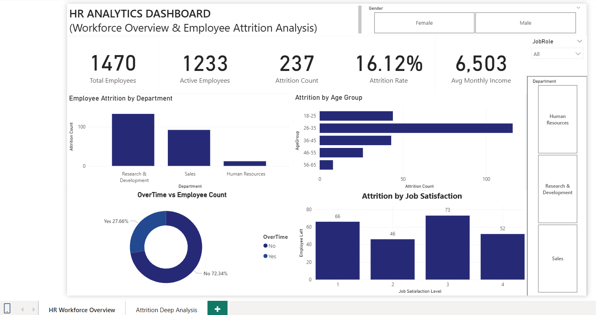
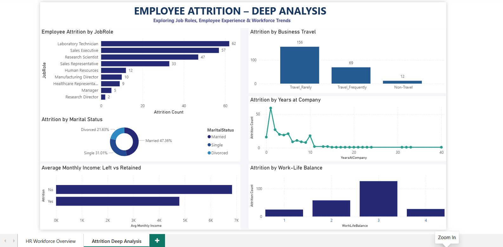

# HR Analytics – Employee Attrition & Workforce Analysis

## Project Overview
An end-to-end HR Analytics project to analyze employee attrition and workforce trends using Python, MySQL, and Power BI.

## Business Objective
To identify employee attrition patterns across departments, job roles, age groups, overtime, job satisfaction, and other workforce factors.

## Tools & Technologies
- Python: Pandas, NumPy, Matplotlib, Seaborn
- MySQL: SQL queries, CTEs, Aggregations, Window Functions
- Power BI: Interactive Dashboards, DAX, KPI Cards, Slicers

## Dataset
IBM HR Analytics Employee Attrition & Performance Dataset
- Total Employees: 1,470
- Original Columns: 35

## Project Workflow

### 1. Python – Data Analysis
- Data inspection and cleaning
- Missing values and duplicate checks
- Exploratory Data Analysis (EDA)
- Attrition analysis and visualizations

### 2. MySQL – SQL Analysis
- Database and table creation
- Department-wise attrition analysis
- Overtime and age-group analysis
- CTEs and Window Functions

### 3. Power BI – Dashboard Development
Created a two-page interactive dashboard.

**Page 1: HR Workforce Overview**
- Workforce KPIs
- Department-wise attrition
- Age group analysis
- Overtime distribution
- Job satisfaction

**Page 2: Attrition Deep Analysis**
- Job role analysis
- Marital status
- Business travel
- Years at company
- Monthly income comparison
- Work-life balance

## Key Insights
- Overall attrition rate: 16.12%
- Sales department attrition rate: 20.63%
- Overtime employees' attrition rate: 30.53%
- Highest age-group attrition: 18–25 years (35.77%)

## Business Recommendations
- Review overtime and workload policies.
- Improve onboarding and mentoring.
- Monitor employee satisfaction.
- Review compensation and career development opportunities.

## Skills Demonstrated
Python | SQL | MySQL | Power BI | DAX | Data Cleaning | EDA | Data Visualization | Business Analysis

## Conclusion
This project demonstrates how Python, SQL, and Power BI can be used together to transform HR data into meaningful business insights and support data-driven decision-making.

**Note:** Findings represent associations in the dataset and do not establish direct causes of attrition.

## Dashboard Preview

### Page 1 – HR Workforce Overview

### Page 2 – Attrition Deep Analysis

